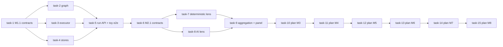

# alpha-nodes Implementation Plan

> **For agentic workers:** you are implementing one Backlog.md task. Read that task file,
> this document, and the design sections the task references. Follow the task's Steps in
> order (TDD), and stay inside its **Files** list. The coordinator workflow is in
> `documentation/workflow.md`.

**Goal:** Build `lensgraph`, the generic candidates × lenses → dossiers core. Then build
`alpha_nodes`, the finance domain for equity universe construction, on top of it.

**Architecture:**
- **Graph:** class-based pydantic nodes with consumer-declared dependencies, resolved into
  a per-candidate execution plan.
- **Execution:** an asyncio executor with failure-as-data semantics and content-addressed
  memoization, over a file blob store and a DuckDB run index.
- **Lenses:** deterministic or AI. Verdicts are aggregated into dossiers. AI lenses run
  through pydantic-ai with a citation guard rail.

**Tech stack:** Python 3.13, uv workspace, pydantic v2, pydantic-settings, pandas 3 +
pandera, DuckDB, pyarrow, pydantic-ai-slim 2.71, Jinja2; pytest + pytest-asyncio, ruff, pyright.

**Spec:** `documentation/design/overview.md`, `core.md`, `finance.md`, `lessons.md`.

## Global Constraints

- Python `>=3.13,<3.14`, managed with uv (workspace root `pyproject.toml`, members `packages/*`).
- `lensgraph` never imports `alpha_nodes` or contains finance concepts.
- Pydantic-first: project data structures are pydantic models (`extra="forbid"`; `frozen=True` for hashed or cached values).
  - No `@dataclass`, `TypedDict` or `NamedTuple`.
  - Frames are pandas, validated by pandera (`import pandera.pandas as pa`).
- Node params are the node's pydantic fields. Structural metadata are `ClassVar`s.
- AI nodes never produce numbers consumed by calculations. Output must pass the schema and citation checks, or the node fails. No placeholder fallbacks.
- Lenses never depend on other lenses. Only `consumes_verdicts` nodes (aggregators) read verdicts.
- The default LLM profile is `dev` = `anthropic:claude-haiku-5-5` with `{"thinking": "low"}`.
- Tests: pytest functions + fixtures (no test classes), `conftest.py` for shared fixtures, `asyncio_mode = "auto"`.
  - No network and no real LLM calls: fake providers, pydantic-ai `FunctionModel`/`TestModel`, `ALLOW_MODEL_REQUESTS = False`.
- No pickle in persistent stores.
- Every task passes: `uv run pytest`, `uv run ruff check`, `uv run pyright` (basic).
- UI tasks (`packages/lensgraph-ui`, pnpm) also pass `pnpm -C packages/lensgraph-ui test` and `typecheck`. The built bundle is committed into the Python package; Python tests check it is up to date, so Python-only work never needs Node.
- Docs: if behaviour differs from `documentation/design/*`, update the doc in the same change.

## Review Focus

Five inputs or conditions the spec implies but no happy-path test covers. Each has a pinned
test in the owning task:

1. **Duplicate candidate ids in a run.** Expected: `DuplicateCandidateError` at plan time,
   not silently merged results. (task-2 `test_duplicate_candidate_ids_rejected`)
2. **A run that crashes midway (provider outage).** Expected: the next run resumes from cache
   for everything that finished. (task-5 `test_abort_then_resume_from_cache`)
3. **Awkward values reaching the blob store:**
   - an empty frame with dtypes
   - a tz-aware index
   - a numpy scalar
   - a list of models
   - `Absent`

   Expected: lossless round-trip, or a clear `TypeError`, never pickle.
   (task-4 `test_roundtrip_types`, `test_unsupported_type_raises`)
4. **An LLM citing a near-miss id** (case or whitespace variant). Expected: rejected and
   retried with the valid ids listed. Never fuzzy-matched. (task-8 `test_citation_case_variant_rejected`)
5. **A candidate whose lenses all fail or abstain.** Expected: a dossier with
   `overall_stance=None`, `confidence=0.0` and no exception. (task-9 `test_all_failed_or_abstained`)

## Milestones and task graph

| Milestone | Tasks | State |
|---|---|---|
| M1 Core graph | task-1 → {task-2, task-3, task-4} → task-5 | detailed |
| M2 Lenses and dossiers | task-6 → {task-7, task-8} → task-9 | detailed |
| M3 Run config, lineage and HTML report | task-10 (plan) | sketched |
| M4 Source store and yfinance prices | task-11 (plan) | sketched |
| M5 Price-behaviour lens end-to-end | {task-43, task-44} → {task-45, task-46, task-47} → task-48 | detailed |
| M6 Fundamentals lenses | task-13 (plan) | sketched |
| M7 Campaigns and universe construction | task-14 (plan) | sketched |
| M8 As-of runs and lens backtests | task-15 (plan) | sketched |

Plan tasks (label `plan`) are done by the coordinator. Each one creates that milestone's
detailed tasks and re-points the next plan task's dependency at the milestone's final task.
This is rolling-wave planning: only the next one or two milestones are ever detailed.

Interfaces cross task boundaries in exactly the places each task's **Interfaces** block
names. If an implementer needs a name another task doesn't produce, they stop and ask the
coordinator rather than invent it.
